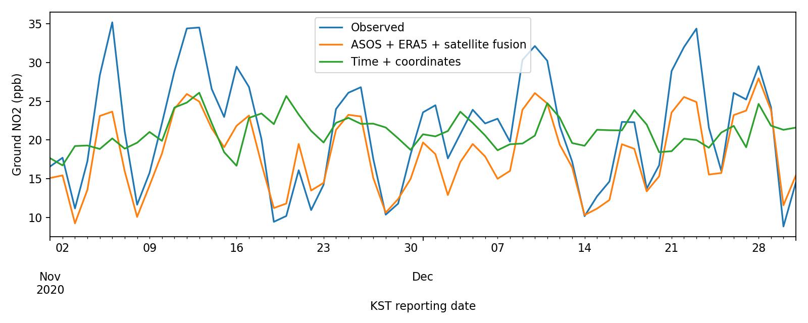
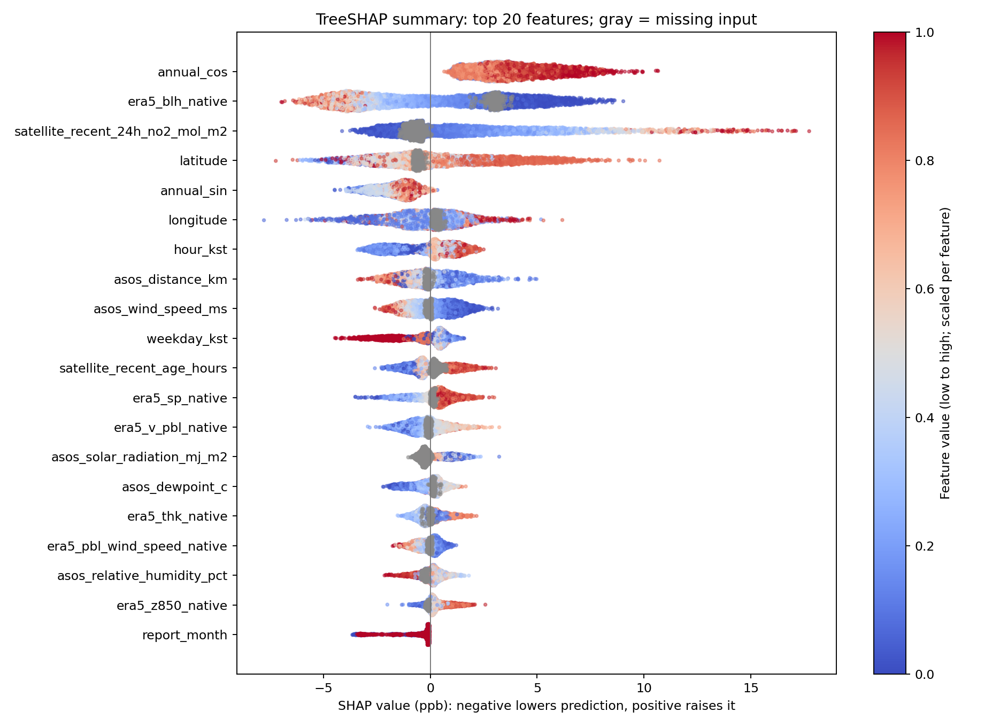

# 지상 NO₂ LightGBM 융합 모델 및 SHAP 분석

2020년 AirKorea 도시대기 실측 NO₂(ppb)를 타깃으로, 시간·현재 측정소 좌표·ASOS·ERA5·TROPOMI를 결합한 연구용 모델입니다.

## 평가 결과

학습 1–8월, 검증 9–10월, 평가 11–12월. 동일한 평가 관측 652,496개에서 비교했습니다.

| 모델 | RMSE (ppb) | MAE (ppb) | R² |
|---|---:|---:|---:|
| 시간 | 14.051 | 11.293 | 0.054 |
| 시간 + 좌표 | 12.162 | 9.344 | 0.291 |
| ASOS + ERA5 + 위성 융합 | 9.454 | 6.577 | 0.572 |

입력 38개, 선택 트리 1,454개. 평가 평균 편향은 -3.136 ppb입니다.

## 결과 열기

- [PDF 결과 보고서](../results/NO2_LightGBM_2020_fusion/NO2_fusion_report.pdf)
- [융합 모델](../results/NO2_LightGBM_2020_fusion/lightgbm_fusion_model.txt)
- [처리 방법과 한계](../results/NO2_LightGBM_2020_fusion/README.md)
- [전체 평가 지표](../results/NO2_LightGBM_2020_fusion/metrics.json)
- [SHAP 분석 설명](../results/NO2_LightGBM_2020_fusion/SHAP/README.md)
- [SHAP 중요도 표](../results/NO2_LightGBM_2020_fusion/SHAP/global_shap_importance.csv)

HTML 보고서는 저장소를 다운로드한 뒤 로컬 브라우저에서 열 수 있습니다.

## 평가 그래프

## SHAP

LightGBM 내장 TreeSHAP으로 평가 관측에서 무작위 5,000개(seed=42)를 분석했습니다. 추가 사례는 전역 중요도에서 제외했습니다. 기준값+SHAP 합=모델 예측을 검증했습니다.

## 해석 및 재현 범위

- 현재 좌표는 과거 이전 이력을 검증하지 않고 사용했습니다.
- 위성 원화소 좌표·정확한 시각이 없어 제공 노드/hour-bin 기반 연결입니다.
- 시간평균 구간을 독립 검증한 정합은 아닙니다. 공간 독립 검증도 수행하지 않았습니다.
- SHAP은 11–12월 표본의 모델 기여도이며 인과효과가 아닙니다.
- 결측 정답은 보간하지 않고 학습·평가에서 제외했습니다. 입력 NaN은 유지했습니다.
- 모델·평가·SHAP·스크립트와 메타데이터를 포함합니다. 대용량 학습 배열/전체 결합표, 원시 다운로드 자료와 API 키는 포함하지 않습니다.
- 스크립트는 원 실행 환경의 경로와 선행 산출물을 참조합니다. 이 저장소만으로 원자료 준비부터 즉시 재현되는 구성은 아닙니다. Python/LightGBM 버전과 설정은 metrics.json, 입력 출처와 SHA256은 data_metadata.json에 있습니다.

원자료 출처: AirKorea(한국환경공단/국립환경과학원), 기상청 ASOS, 제공된 ERA5 및 TROPOMI 처리자료. 원자료의 이용조건은 각 제공기관 기준을 확인하세요.
